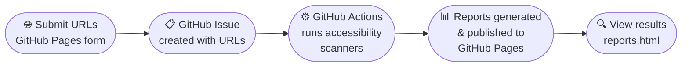

# Open Scans

[](https://www.gnu.org/licenses/agpl-3.0)
[](https://github.com/mgifford/open-scans/actions/workflows/deploy-pages.yml)
[](https://github.com/mgifford/open-scans/actions/workflows/scan-request.yml)
[](https://github.com/mgifford/open-scans/actions/workflows/scan-issue-queue.yml)

Issue-driven accessibility scanning using GitHub Pages and GitHub Actions. This project was inspired by [Oobee](https://github.com/GovTechSG/oobee) a project of [GovTech Singapore](https://www.tech.gov.sg/).

**Live site**: [https://mgifford.github.io/open-scans/](https://mgifford.github.io/open-scans/)  
**Reports**: [https://mgifford.github.io/open-scans/reports.html](https://mgifford.github.io/open-scans/reports.html)

---

## Table of Contents

- [What it is](#what-it-is)
- [Who this is for](#who-this-is-for)
- [How it works](#how-it-works)
- [Quick Start](#quick-start)
- [Choose Scanning Engines](#choose-scanning-engines)
- [ACT Laboratory (weekly)](#act-laboratory-weekly)
- [Performance Investigation (`PERF:`)](#performance-investigation-perf)
- [View Scan Results](#view-scan-results)
- [Pattern and Container Inventory](#pattern-and-container-inventory)
- [Compare Baseline and Optimized Scans](#compare-baseline-and-optimized-scans)
- [Review Optimization Accessibility](#review-optimization-accessibility)
- [Managing Your Scans](#managing-your-scans)
- [Scanning Triggers](#scanning-triggers)
- [Security & Privacy](#security--privacy)
- [Troubleshooting](#troubleshooting)
- [Architecture](#architecture)
- [Configuration](#configuration)
- [Development](#development)
- [Documentation](#documentation)
- [Current Status](#current-status)
- [Related Projects](#related-projects)
- [AI Disclosure](#ai-disclosure)
- [License](#license)

---

## What it is

- Accepts URL batches from a GitHub Pages form
- Creates scan-request GitHub issues
- Runs multi-engine accessibility scans in GitHub Actions
- Publishes comparison-ready results to GitHub Pages

## Who this is for

- **Content and design teams** who want batch accessibility scans without standing up infrastructure
- **Accessibility practitioners** who want multi-engine comparisons (axe, ALFA, IBM Equal Access, and more) over time
- **Developers and DevOps teams** who want an issue-driven scanning pipeline built on GitHub Actions
- **Anyone** who needs recurring, scheduled accessibility monitoring of publicly accessible URLs

## How it works



1. **Submit** — Paste your URLs into the form at the [GitHub Pages site](https://mgifford.github.io/open-scans/)
2. **Issue created** — The form pre-fills a GitHub issue; submitting it triggers the scan pipeline
3. **Actions scan** — GitHub Actions runs the selected accessibility engines against each URL
4. **Reports published** — Scan results are committed back to the repository and published to GitHub Pages
5. **View results** — Browse all completed scans at the [Reports page](https://mgifford.github.io/open-scans/reports.html)

## Quick Start

### Submit Your Scan in 5 Minutes

1. **Prepare your URLs**: Gather the web pages you want to scan (recommended: 100–150 URLs per batch)
2. **Submit your scan**: Go to [https://mgifford.github.io/open-scans/](https://mgifford.github.io/open-scans/)
   - Enter a descriptive title for your scan
   - Paste your URLs (one per line or comma-separated)
   - Click "Create Scan Request" — this creates a GitHub issue that triggers the scan
3. **Wait for results**: Scans typically complete in 30–60 minutes depending on the number of URLs
4. **View your report**: Check [https://mgifford.github.io/open-scans/reports.html](https://mgifford.github.io/open-scans/reports.html) for your completed scan results

### Integration with Top Task Finder

If you're using the [Top Task Finder](https://mgifford.github.io/top-task-finder/) to identify your most important pages, open-scans is the perfect next step:

1. **Identify your top tasks**: Use the Top Task Finder to determine which pages are most critical for your users
2. **Export your URLs**: Get the list of URLs corresponding to your top tasks
3. **Scan for accessibility**: Paste those URLs into open-scans to check for accessibility issues
4. **Prioritize fixes**: Focus on fixing accessibility issues on your most important pages first

## Choose Scanning Engines

By default, **axe** plus one randomly selected engine run for a balanced result. Use `ALL` to run all four supported rule engines.

### Available Engines

| Engine | Keyword | Description |
| :--- | :--- | :--- |
| axe-core | `AXE` | Deque's industry-standard accessibility testing engine |
| Siteimprove ALFA | `ALFA` | Siteimprove's open-source, ACT-rules-based engine |
| IBM Equal Access | `EQUALACCESS` | IBM's comprehensive accessibility checker |
| AccessLint | `ACCESSLINT` | Automated accessibility testing tool |

### Specifying Engines

**Option 1 — In the issue title**: include one or more engine keywords (removed automatically from the scan title):

```
SCAN: AXE ALFA Homepage accessibility check
SCAN: ALL Complete accessibility audit
```

**Option 2 — In the first line of the issue body**: use an `Engine:` prefix (overrides title keywords):

```
Engine: axe, alfa
```

**Examples**:
- `SCAN: AXE Homepage check` — Runs only axe-core
- `SCAN: ALFA EQUALACCESS Government site scan` — Runs ALFA and Equal Access
- `SCAN: ALL Complete audit` — Runs all four supported rule engines (axe, ALFA, Equal Access and AccessLint)
- `SCAN: Homepage check` — Runs axe + one randomly chosen engine (default)
- Body: `Engine: axe accesslint` — Runs axe and AccessLint regardless of title

The leading `#` is accepted on any runnable prefix, so `SCAN:` and `#SCAN:` are
equivalent, as are `SUNDAY:` and `#SUNDAY:`. Engine keywords work with timed
prefixes too, for example `#SUNDAY: ALL`.

> **ACT laboratory:** the weekly ACT comparison does **not** use an issue, a
> title prefix or an engine keyword. See
> [ACT Laboratory (weekly)](#act-laboratory-weekly).

### ACT Laboratory (weekly)

The ACT laboratory comparison is a separate workflow, not an issue-driven
scan. It has no issue title syntax and never uses the engine selection above.

- **Schedule:** every Sunday at 06:00 UTC
  (`.github/workflows/act-lab-weekly.yml`).
- **Targets:** all fixtures from the published
  `https://mgifford.github.io/record-a-goose-sighting/lab/fixtures.json`
  manifest, with **all operational engines**.
- **Viewports:** desktop 1280×800, tablet portrait 768×1024 and mobile portrait
  390×844, each with light and dark colour schemes.
- **Other test beds:** the manual run accepts `site_root` and `manifest_path`,
  so a team can point it at their own fixture manifest. See
  [`act-lab/README.md`](act-lab/README.md) for the contract and a minimal
  manifest.
- **Skip rule:** if the fixture manifest, installed engine versions, ACT rule
  mapping and upstream W3C test-case data are all unchanged since the last
  successful run, the workflow skips the scan and says why in the job summary.
  A missing finding is never recorded as a pass.
- **Manual run:** Actions → **ACT Laboratory (weekly)** → *Run workflow*.
  Enable **force** to run even when the cohort is unchanged.
- **Reports:** `act-lab/latest.json` (merged observations), per-viewport files
  and `act-lab/state.json` (cohort), described in
  [`act-lab/README.md`](act-lab/README.md). Results classify findings as
  target ACT rule, another ACT rule, or engine-specific.

Do not open a `SCAN:` or timed issue for the ACT laboratory: that would run a
plain page scan instead of the fixture comparison.

## Performance Investigation (`PERF:`)

Performance investigation is a **separate request type** from accessibility scanning. It currently covers **PR 1: request contract**, **PR 2: evidence model and existing-source adapters**, **PR 3: bounded Lighthouse collection**, **PR 4: targeted Sitespeed deep investigation**, and **PR 5: cross-page investigation**. A `PERF:` issue is parsed, validated and then executed by the separate **Performance Scan** workflow. `reuse`, `light` and `deep` modes run; `combined` is validated but not yet executable. The reuse runner assembles existing Open Scans, Firefox Energy Scanner, Vital Core and Open Site Review evidence with **no browser launch**; the light runner reuses that evidence first and only runs bounded Lighthouse on the remaining selected pages; the deep runner runs a bounded Sitespeed investigation. Raw provider artifacts are uploaded as workflow artifacts and are not committed; evidence, run report and summary are published under `reports/performance/`.

```text
PERF: example.gov performance investigation
```

The issue body selects a mode and, optionally, existing evidence:

```markdown
### Performance mode
reuse

### Domain
example.gov

### URLs
https://example.gov/
https://example.gov/services

### Evidence sources
vital-core: https://vital.example.gov/api/v1/example.gov/snapshot.json
firefox-energy-scanner: https://example.gov/energy/result.json

### Limits
Max pages to inspect: 20
Max Lighthouse audits: 0
Max Sitespeed pages: 0
```

| Mode | What it may do |
| :--- | :--- |
| `reuse` | Import existing evidence only. Performs no browser measurement. |
| `light` | Bounded Lighthouse and lightweight resource analysis only where evidence is missing. |
| `deep` | Add Sitespeed.io on a small selected page set. |
| `combined` | Run an explicitly selected accessibility scan as well. |

A performance request never implies axe, ALFA, IBM Equal Access or AccessLint. A `SCAN:` request never becomes a performance scan, and `SCAN:` never triggers Sitespeed.io. In `combined` mode the accessibility engines must be named explicitly; there is no random default.

Contract and assessment documents:

- [`scanner/schemas/performance-request.schema.json`](./scanner/schemas/performance-request.schema.json) — versioned `performance-request/1` contract
- [`scanner/parse-performance-issue.mjs`](./scanner/parse-performance-issue.mjs) — deterministic parser and validator (no browser, no network)
- [`docs/performance/performance-request-contract.md`](./docs/performance/performance-request-contract.md) — body format, fields, modes and validation rules
- [`docs/performance/performance-evidence.md`](./docs/performance/performance-evidence.md) — common `performance-evidence/1` entities, identity and merge rules
- [`docs/performance/PHASE-0-ASSESSMENT.md`](./docs/performance/PHASE-0-ASSESSMENT.md) — provider inventory, duplicate-measurement map and compatibility risks
- [`docs/performance/ADR-001-performance-workflow-in-open-scans.md`](./docs/performance/ADR-001-performance-workflow-in-open-scans.md) — why the workflow lives here
- [`docs/performance/PR-2-EVIDENCE-ADAPTERS.md`](./docs/performance/PR-2-EVIDENCE-ADAPTERS.md) — what PR 2 implemented and deliberately omitted
- [`docs/performance/PR-3-LIGHTHOUSE.md`](./docs/performance/PR-3-LIGHTHOUSE.md) — bounded Lighthouse provider, page selection and cost accounting
- [`docs/performance/PR-4-SITESPEED.md`](./docs/performance/PR-4-SITESPEED.md) — targeted Sitespeed deep investigation, CO2.js provenance and safety limits
- [`docs/performance/performance-investigation.md`](./docs/performance/performance-investigation.md) — cross-page grouping, phases, ranking and bidirectional indexes
- [`docs/performance/PR-5-INVESTIGATION.md`](./docs/performance/PR-5-INVESTIGATION.md) — PR 5 scope, tests and limitations
- [`docs/performance/performance-execution.md`](./docs/performance/performance-execution.md) — validation vs execution workflows, modes and artifacts

Use the **Performance Request** issue template, or run the parser locally:

```bash
node scanner/parse-performance-issue.mjs tests/fixtures/performance-issue-reuse.json
```

Assemble existing evidence without launching a browser:

```bash
node scanner/run-performance-reuse.mjs tests/fixtures/performance-issue-reuse.json \
  --source firefox-energy-scanner=/path/to/result.json \
  --source vital-core=/path/to/snapshot.json \
  --allow-local --out evidence.json --summary evidence.md
```

The reuse runner accepts a validated request, a parser result, or the original issue event. Local paths require an explicit `--source` override and `--allow-local`. A source that cannot be adapted is omitted with a visible limitation; the runner never falls back to a new scan.

Run the bounded light investigation (reuses compatible evidence before launching Chromium):

```bash
node scanner/run-performance-light.mjs performance-request.json \
  --chrome-path "/Applications/Google Chrome.app/Contents/MacOS/Google Chrome" \
  --artifacts-dir .scan-output/performance/lighthouse \
  --out evidence.json --run-report run.json --summary summary.md
```

Lighthouse is pinned to `13.6.0`. Raw Lighthouse JSON stays in the bounded artifacts directory; the evidence package keeps source-linked metrics and the run report records browser launches, audits, reused pages and duration.

Run a targeted deep investigation on a shortlist (Docker + pinned Sitespeed image):

```bash
node scanner/run-performance-deep.mjs performance-request.json \
  --artifacts-dir .scan-output/performance/sitespeed \
  --out evidence.json --run-report run.json --summary summary.md
```

Sitespeed uses `sitespeedio/sitespeed.io:43.0.0`, `analysisstorer`, Sustainable Web Design v4 and a maximum of three pages per run. It never scans the full discovery crawl, never shares a Playwright session, and keeps modelled CO2e separate from Firefox energy.

Group evidence across pages into ranked investigation candidates without a browser, network or LLM:

```bash
node scanner/run-performance-investigation.mjs evidence.json \
  --out investigation.json --summary investigation.md
```

Candidates are grouped by component type, resource or page, never by class name. Shared navigation on several pages is one candidate; unrelated navigation implementations stay separate. The package includes coverage, uncertainty, candidate interventions and bidirectional indexes, but no aggregate performance or energy score.

## View Scan Results

Visit the [Reports page](https://mgifford.github.io/open-scans/reports.html) to see all completed scans with:
- Issue number and scan title
- Scan timestamp and number of URLs scanned
- Pass/fail/can't tell statistics
- Links to detailed reports (Markdown, CSV, JSON)

## Pattern and Container Inventory

Every scan now summarizes **unique accessibility patterns** using the existing Pattern IDs, and groups them by a conservative semantic container candidate: navigation, forms, form controls, header, footer, main content, tables, lists, dialogs and more.

- `report.json` → `patternInventory`
- `report.md` and `report.html` → category/pattern tables
- `patterns.csv` → one row per pattern

A pattern like `nav a.icon` is reported under **Navigation**; `form#search input` under **Forms**; `input#email` under **Forms → form controls**. The container is a candidate, not a component-ownership claim, and it is not derived from the Firefox Energy Scanner graph or Playwright MCP data.

The inventory also reports locator coverage (`selector`, `mixed`, `html-only`, `none`) so missing XPath/selector evidence is visible. Equal Access `path.dom` is now retained; older reports need a re-scan to benefit.

Read the [pattern inventory documentation](./docs/pattern-inventory.md).

### Accessibility context for FES

Each scan also writes a compact `accessibility-context.json` (and CSV) with one record per finding occurrence: page URL, selector, explicit `selectorType` (`css`/`xpath`/`html`/`none`/`unknown`), pattern ID, WCAG/ACT mapping and a semantic-container candidate. This is the handoff Firefox Energy Scanner can join to its component graph. It contains accessibility evidence only—no energy, Lighthouse, Sitespeed or ownership claim.

See [accessibility context](./docs/accessibility-context.md) and [product direction](./docs/PRODUCT-DIRECTION.md).

## Compare Baseline and Optimized Scans

Open Scans can compare two **stored** scan reports without running another scan. This is useful when a performance or energy optimization changes navigation, scripts, images, CSS, or a third-party widget and you need to know whether accessibility changed.

```bash
npm run compare:scans -- \
  reports/issues/issue-123/2026-11-01T.../report.json \
  reports/issues/issue-123/2026-11-15T.../report.json \
  --baseline-release v1.0.0 --comparison-release v1.1.0 \
  --out comparison.json --summary comparison.md --csv comparison.csv --html comparison.html
```

- Same URLs are paired by default.
- Staging or preview URLs require an explicit `--page-map "https://prod/page=https://staging/page"`.
- Findings are classified as **new**, **persistent**, **details changed**, **not observed**, or **not evaluated**.
- A finding that is no longer observed is **never automatically called fixed**. Missing pages, failed engines and changed test conditions remain visible.
- The report includes browser, viewport, colour scheme, engine and release information, plus manual-testing limits.
- Outputs are versioned JSON, Markdown, CSV and a self-contained accessible HTML report.
- Findings preserve ACT Rule mappings and carry explicit component identifiers or low-confidence selector-derived semantic regions. Labels are never used as identity and no component ownership is inferred.
- An optional `--external-references references.json` file can link the comparison to Firefox Energy Scanner or Vital Core. It is metadata-only: URLs are validated but never fetched, and the external evidence is not treated as an accessibility finding.
- The generated comparison report has section navigation, a plain-language “What changed” summary, status definitions, per-finding evidence disclosures and a manual-verification section. It is fully usable without JavaScript.
- JSON and CSV exports retain baseline/comparison scan metadata, source reports, testing conditions, page mappings, finding identities, component/region evidence, external investigation ids and coverage limitations. CSV keeps its original columns and appends the new fields.

Read the [comparison documentation](./docs/accessibility-comparison/comparison.md) and the [Phase 0 assessment](./docs/accessibility-comparison/PHASE-0-ASSESSMENT.md).

## Review Optimization Accessibility

After comparing a baseline and an optimized implementation, describe the optimization and review the accessibility evidence that matters:

```bash
npm run investigate:optimization -- comparison.json \
  --scenario replacing-navigation \
  --scenario reducing-or-removing-animation \
  --out optimization.json --summary optimization.md --html optimization.html
```

Supported scenarios include script removal/deferral, navigation replacement, lazy-loading, animation reduction, third-party replacement, DOM simplification, CSS removal, progressive-enhancement changes and lighter component replacement.

The report:

- reuses the existing comparison findings; it does not run another scanner;
- maps findings to accessibility concerns such as names, keyboard operation, focus, headings, landmarks, forms, live regions, reduced motion, forced colours and disappearing content;
- says **“not a pass”** when no matching automated finding exists;
- requires human review for keyboard, screen-reader, motion, forced-colours and functional-equivalence checks;
- never claims WCAG conformance, functional equivalence, or energy/performance savings;
- carries linked external performance/energy investigations forward as metadata, with an explicit evidence boundary.

Read the [optimization investigation documentation](./docs/accessibility-comparison/optimization-investigation.md).

## Managing Your Scans

### Submit URLs for Scanning

1. Visit the [GitHub Pages site](https://mgifford.github.io/open-scans/)
2. Enter a descriptive scan title (e.g., "GSA.gov Homepage and Key Pages")
3. Enter your URLs (one per line or comma-separated)
4. Review the validation preview showing accepted/rejected URLs
5. Click "Create Scan Request" to be redirected to GitHub
6. Review and submit the pre-filled issue to start the scan

**URL limits**:
- **Hard limit**: the form accepts up to 500 URLs
- **Recommended batch size**: 100–150 URLs for reliable results within Actions time limits
- Split larger site audits across multiple issues to avoid timeout issues

The form validates URLs in real-time and blocks:
- Localhost URLs
- Private IP addresses (10.x.x.x, 172.16–31.x.x, 192.168.x.x)
- Link-local addresses (169.254.x.x)
- Private IPv6 addresses

### Converting to Recurring Scans

If you find the scan results useful and want to run the same scan regularly:

1. **Find your scan issue**: Go to [https://github.com/mgifford/open-scans/issues](https://github.com/mgifford/open-scans/issues)
   - Your issue may be closed after the scan completes — use the search/filter if needed

2. **Edit the issue title**: Change the prefix from `SCAN:` to one of the following:
   - `WEEKLY:` — Runs on the same day of the week the issue was created
   - `SUNDAY:` through `SATURDAY:` — Runs on that specific day each week
   - `MONTHLY:` — Runs on the 1st of each month
   - `QUARTERLY:` — Runs on Jan 1, Apr 1, Jul 1, Oct 1

   The prefix must be the **first text** in the title. `SUNDAY:` and `#SUNDAY:`
   both work; a trailing day word does not, so
   `SCAN: https://example.com SUNDAY` remains a one-off scan. Engine keywords
   may follow the prefix, for example `SUNDAY: ALL`, with the URL in the body.

3. **Reopen the issue** if it was closed, so scheduled scans will run

### Updating Your URL List

1. Open your scan issue on GitHub
2. Click the edit (pencil) icon on the issue description
3. Modify the URL list in the issue body and save
4. The next scheduled scan (or manual trigger) will use the updated URL list

### Cleaning Up

To stop recurring scans:

- **Option 1**: Change the title prefix back to `SCAN:` or any other text
- **Option 2**: Close the issue — closed issues are not processed by scheduled workflows
- **Option 3**: Delete the issue entirely

## Scanning Triggers

### 1. Automatic On Issue Creation/Edit

When an issue titled with `SCAN:` or `#SCAN:` is created or edited, the "Scan Request" workflow triggers automatically. Multiple `SCAN:` issues are processed sequentially to prevent conflicts.

### 2. Daily Scheduled Scans

- **Scan All Open SCAN Issues** (`scan-issue-queue.yml`) — runs daily at midnight UTC, processes all open `SCAN:` issues
- **Scan Timed Issues** (`scheduled-scan-queue.yml`) — runs daily at 00:15 UTC, processes only timed issues (`WEEKLY:`, `MONTHLY:`, etc.) that are due that day

Engine keywords work with timed scans too (e.g., `WEEKLY: AXE Monday scan`).

### 3. Weekly ACT Laboratory

The ACT laboratory runs separately from issue-driven scans, every Sunday at
06:00 UTC. It targets the published fixture manifest with all operational
engines and skips the run when nothing in its cohort has changed. See
[ACT Laboratory (weekly)](#act-laboratory-weekly) for the details.

### 4. Manual Trigger

1. Go to the [Actions tab](https://github.com/mgifford/open-scans/actions)
2. Select the appropriate workflow:
   - **"Scan All Open SCAN Issues"** — for pending `SCAN:` issues
   - **"Scan Timed Issues (WEEKLY, MONTHLY, etc.)"** — for recurring timed issues due today
   - **"ACT Laboratory (weekly)"** — for the fixture comparison, with an optional force
   - **"AI Accessibility Review (weekly)"** — for an AI-powered WCAG 2.2 source-code review (see below)
3. Click "Run workflow"

### 4. AI Accessibility Review (weekly)

The **AI Accessibility Review** workflow (`ai-accessibility-review.yml`) is inspired by [GitHubNext's daily-accessibility-review](https://github.com/githubnext/agentics/blob/main/docs/daily-accessibility-review.md). It uses the GitHub Models API to review the project's own HTML and JavaScript source files for WCAG 2.2 Level AA accessibility issues, then creates a GitHub issue documenting any findings.

**Schedule:** Runs automatically every **Monday at 18:00 UTC** (evening). Can also be triggered manually at any time via the Actions tab.

**What it does differently from runtime scanning:**
- Reviews *source code* rather than the rendered live site — catches structural and semantic issues that runtime scanners can miss
- Provides natural-language WCAG 2.2 criterion mapping and actionable remediation guidance
- Complements (does not replace) the existing axe-core runtime scan in `scan-github-pages.yml`

**How to run it manually:**
1. Go to [Actions → AI Accessibility Review (weekly)](https://github.com/mgifford/open-scans/actions/workflows/ai-accessibility-review.yml)
2. Click **Run workflow**
3. Optionally specify custom files to review (defaults to `index.html reports.html trends.html submit.js`)
4. A GitHub issue will be created with the AI review findings

This workflow requires no secrets beyond the built-in `GITHUB_TOKEN` (which has `models:read` scope in GitHub Actions).

### 5. Accessibility Engine Version Check (monthly)

The **Accessibility Engine Version Check** workflow (`engine-version-check.yml`) compares the installed version of each scanning engine dependency (ALFA, axe-core, IBM Equal Access, AccessLint) against the latest release on npm and opens or updates a tracking issue when any are behind.

**Why this exists:** manually curated rule metadata (`scanner/alfa-rule-metadata.mjs`, `scanner/rule-metadata.mjs`, `scanner/equalaccess-rule-metadata.mjs`) maps opaque rule IDs to human-readable names and WCAG criteria. That mapping can silently drift out of sync as an engine ships new rule numbering or reclassifies a rule's WCAG mapping — this happened with ALFA's SIA-R65 and SIA-R83 rules. A monthly nudge to check for engine updates is also a prompt to re-verify the metadata against the new version.

**Schedule:** Runs automatically on the **1st of every month at 09:00 UTC**. Can also be triggered manually via the Actions tab.

**How to run it manually:**
1. Go to [Actions → Accessibility Engine Version Check (monthly)](https://github.com/mgifford/open-scans/actions/workflows/engine-version-check.yml)
2. Click **Run workflow**
3. If any engines are outdated, a tracking issue is created (or the existing one updated) listing installed vs. latest versions

## Security & Privacy

- **Only public URLs are scanned** — the form blocks localhost, private IP ranges, and link-local addresses
- **Results are published publicly** to GitHub Pages — do not submit URLs that should remain private
- **No authentication support** — URLs behind login walls cannot be scanned
- See [SECURITY.md](./SECURITY.md) for the full security policy

## Troubleshooting

**Scan not appearing after 30–60 minutes?**
- [View workflow history in GitHub Actions](https://github.com/mgifford/open-scans/actions) to check for errors
- Look for your scan issue number in the workflow runs
- Common issues: invalid URLs, network timeouts, or all URLs blocked by validation

**Need help?**
- Review [workflow run logs](https://github.com/mgifford/open-scans/actions) for detailed error messages
- Verify your URLs are publicly accessible (test in an incognito window)
- Ensure URLs don't include localhost or private IP addresses

## Architecture

### Frontend (GitHub Pages)
- **index.html**: URL submission form with real-time validation
- **reports.html**: Scan results dashboard
- **submit.js**: Client-side URL parsing, validation, and GitHub integration

### Backend (GitHub Actions)
- **scanner/parse-issue.mjs**: Extracts URLs and engine specifications from scan request issues
- **scanner/parse-performance-issue.mjs**: Parses and validates `PERF:` requests without launching a browser or running an accessibility engine
- **scanner/schemas/performance-request.schema.json**: Versioned `performance-request/1` contract
- **scanner/performance-evidence.mjs**: Assembles, merges and validates the common `performance-evidence/1` format
- **scanner/adapters/**: Adapters for Open Scans reports, Firefox Energy Scanner, Vital Core and Open Site Review
- **scanner/run-performance-reuse.mjs**: Reuse-only investigation runner (no browser launches)
- **scanner/performance-page-selection.mjs**: Bounded candidate selection and reuse planning
- **scanner/performance-lighthouse.mjs**: Pinned Lighthouse runner and evidence normalizer
- **scanner/run-performance-light.mjs**: Bounded light investigation runner with cost accounting
- **scanner/performance-sitespeed.mjs**: Pinned Sitespeed Docker provider, analysisstorer/sustainable parsing and CO2 provenance
- **scanner/run-performance-deep.mjs**: Targeted Sitespeed deep-investigation runner
- **scanner/run-performance-issue.mjs**: Issue-driven performance dispatcher (`reuse`, `light`, `deep`)
- **scanner/performance-investigation.mjs**: Cross-page component/resource grouping, deduplication and ranking
- **scanner/run-performance-investigation.mjs**: Offline investigation package builder
- **scanner/validate-targets.mjs**: Server-side URL validation
- **scanner/run-scan.mjs**: Executes accessibility scans with selected engines and generates reports
- **scanner/generate-reports-html.mjs**: Builds the reports dashboard
- **scanner/analyse-trends.mjs**: Tracks accessibility metrics over time
- **scanner/check-engine-versions.mjs**: Compares installed vs. latest npm versions for each scanning engine dependency

See [scanner/README.md](./scanner/README.md) for detailed scanner documentation.

## Configuration

### Equal Access Checker (`.achecker.yml`)

- **Policies**: IBM_Accessibility ruleset
- **Fail Levels**: violation, potentialviolation
- **Output Format**: JSON reports
- **Puppeteer Args**: Required for GitHub Actions environment
  - `--no-sandbox`: Bypass Chrome sandbox (required in CI/CD)
  - `--disable-setuid-sandbox`: Additional sandbox bypass

The `puppeteerArgs` configuration is critical for running in GitHub Actions where the Chrome sandbox is not available.

## Development

### Prerequisites

- **Node.js** >= 24 (see `.nvmrc` for the pinned version)
- **uv** for Python dependency management (used by `.kittify/scripts`, install: https://docs.astral.sh/uv/getting-started/installation/)
- Install dependencies: `npm ci`
- Install Python tooling: `uv sync`

### Running Tests Locally

```bash
# Run all unit tests
npm test

# Run only Playwright accessibility unit tests
npm run test:playwright

# Run behavior-driven acceptance tests (Cucumber + Playwright)
npm run test:bdd

# Lint all scanner modules (syntax check)
npm run lint
```

Tests live in `tests/unit/*.test.mjs` and use the Node.js built-in test runner.
Generic Playwright accessibility tests are included in `tests/unit/playwright-accessibility.test.mjs` and auto-skip when Chromium is unavailable.
BDD acceptance tests are in `tests/bdd/features/*.feature` with step definitions in `tests/bdd/steps/*.mjs`.
Use `BDD-TRACEABILITY.md` to map acceptance scenarios back to `FEATURES.md` and existing unit coverage.
Scan workflows install Chromium and run `npm run test:playwright` before executing website scans.

### Running Individual Scanner Modules

```bash
npm run run:parse          # Parse a scan issue
npm run run:validate       # Validate target URLs
npm run run:scan           # Execute a scan
npm run run:generate-reports  # Build the reports dashboard
npm run run:analyse-trends    # Analyse trend data
```

## Documentation

- **[ACCESSIBILITY.md](./ACCESSIBILITY.md)** — Accessibility standards, WCAG 2.2 AA requirements, and development best practices
- **[AGENTS.md](./AGENTS.md)** — AI agent instructions for Copilot, Cursor, Claude, and other coding assistants
- **[SBOM.md](./SBOM.md)** — Software bill of materials with dependency versions, licenses, and update process
- **[SUSTAINABILITY.md](./SUSTAINABILITY.md)** — Digital sustainability policy
- **[TIMEOUT-CONFIG.md](./TIMEOUT-CONFIG.md)** — Timeout configuration and tuning guide for scan optimization
- **[scanner/README.md](./scanner/README.md)** — Scanner module documentation and CLI reference
- **[docs/accessibility-comparison/](./docs/accessibility-comparison/)** — Baseline-to-comparison reports, component/region evidence, optimization investigation, external references, schemas and limitations
- **[docs/pattern-inventory.md](./docs/pattern-inventory.md)** — Per-scan unique patterns by semantic container, JSON/Markdown/HTML/CSV outputs and limits
- **[docs/accessibility-context.md](./docs/accessibility-context.md)** — Compact occurrence-level handoff for Firefox Energy Scanner
- **[docs/PRODUCT-DIRECTION.md](./docs/PRODUCT-DIRECTION.md)** — Open Scans vs Vital Core vs FES boundaries
- **[docs/AI-SESSION-HANDOFF.md](./docs/AI-SESSION-HANDOFF.md)** — Current cross-project state, test baseline and lessons for future AI sessions
- **[.kittify/AGENTS.md](.kittify/AGENTS.md)** — Spec Kitty project management rules

## Current Status

- ✅ WP01 (Foundation and Guardrails) — Complete
- ✅ WP02 (Pages Intake and Issue Submission) — Complete
- 🔄 Next: WP03 (Dual-Scanner Execution Engine)

Planning artifacts and work packages are in `kitty-specs/001-issue-driven-accessibility-scanner/`.

## Related Projects

### Accessibility Tools Suite

`open-scans` is part of a suite of complementary accessibility tools:

| Tool | Description | Link |
| :--- | :--- | :--- |
| **Top Task Finder** | Identifies the top tasks users want to accomplish on a website — useful for prioritising which pages to scan first | [mgifford.github.io/top-task-finder](https://mgifford.github.io/top-task-finder) |
| **Open Scans** | Multi-engine WCAG 2.2 accessibility scanner — the project you are in | [mgifford.github.io/open-scans](https://mgifford.github.io/open-scans) |
| **Alt Text Scan** | Focused scanner for image alternative-text quality across a site | [mgifford.github.io/alt-text-scan](https://mgifford.github.io/alt-text-scan) |

A shared navigation bar links all three tools together so users can move between them without losing context.

### Other companion tools

**[o-hat-scanner](https://github.com/mgifford/o-hat-scanner)** — A companion tool that may be a better fit if you want to embed scanning directly in your own repository's CI pipeline rather than use an issue-driven shared service, or the **[Standalone HTML scanner](https://github.com/mgifford/o-hat-standalone)**: Drop a single file into your site to scan it from the inside (same-origin).

Key differences:
- **targets.yml scheduling**: Define sites, modes (`sitemap`, `crawl`, `list`, `discover`), and cron schedules in one file—no GitHub issues needed.
- **Discovery mode**: Uses Bing SERP + navigation crawl to automatically identify a site's most important pages (useful when you lack a reliable sitemap).
- **Lighter stack**: Primarily axe-core via Playwright; lower setup overhead for single-engine use.

Choose **open-scans** when you need multi-engine comparison (axe, ALFA, IBM Equal Access, AccessLint), cross-engine WCAG overlap analysis, or a no-infrastructure scanning service anyone can trigger via a form.

---

## AI Disclosure

This section documents how AI tools have been used to build and run this project.

### How AI was used to build the project

Development of `open-scans` has used AI coding assistants for:

- Writing and refining scanner modules (`scanner/*.mjs`)
- Drafting and editing documentation (README, AGENTS.md, ACCESSIBILITY.md, SUSTAINABILITY.md)
- Generating and reviewing GitHub Actions workflow configuration
- Code review, debugging, and iterative improvements via PR feedback

### Is any AI used when running the program?

**Optionally, yes.** The `REMEDIATE` keyword in scan issues and the on-demand **AI Accessibility Review** workflow both call the GitHub Models API (gpt-4o-mini) to generate natural-language findings and fix suggestions. These features are entirely opt-in — regular scans and the review workflow only call the API when you explicitly trigger them. The standard scanner is a deterministic Node.js tool that runs established open-source accessibility engines (axe-core, Siteimprove ALFA, IBM Equal Access Checker, AccessLint); no LLM is invoked during normal operation.

### Is browser-based AI enabled?

**No.** Browser-built-in AI features (e.g., the Chrome AI APIs) are not activated by this application. Any future AI features would require explicit user opt-in, per the project's [sustainability policy](./SUSTAINABILITY.md).

### Models and tools used

| Model / tool | Purpose | When used |
| :--- | :--- | :--- |
| GitHub Copilot Coding Agent (GPT-5.4 mini) | Report taxonomy updates, ACT alignment dedupe, interactive report rendering, and unit test adjustments | Development – June 2026 |
| GitHub Copilot (GPT-4-class via OpenAI Codex) | Code generation, CI workflow authoring, documentation drafting | Throughout development |
| GitHub Copilot Chat (GPT-4-class) | Code review, debugging, policy drafting, iterative PR feedback | Throughout development |
| GitHub Copilot Coding Agent (Claude Sonnet 4.5) | Automated PR implementation — AI disclosure instruction in AGENTS.md, AI Disclosure section in README.md | Development – March 2026 |
| GitHub Copilot Coding Agent (claude-sonnet-4.5) | Cross-engine deduplication, WCAG overlap display, issue fingerprinting for historical tracking | Development – March 2026 |
| OpenAI API assistant | Documentation drafting and editing for the scan report Definition of Done in `FEATURES.md` | Development – May 2026 |
| GitHub Copilot Coding Agent (Claude Sonnet 5) | Accessibility engine dependency upgrades (axe-core, accessibility-checker, @accesslint/core, @qualweb packages) | Development – August 2026 |
| GitHub Copilot Coding Agent (claude-sonnet-4.6) | Copilot prompt files for accessibility-first code generation — `.github/prompts/` files and AGENTS.md documentation | Development – March 2026 |
| GitHub Copilot Coding Agent (claude-sonnet-4.6) | Unique identifier (Bug ID) visible display in HTML reports — fingerprint shown as `🔑 Bug ID:` badge in example items | Development – April 2026 |
| GitHub Copilot Coding Agent (claude-sonnet-4.6) | README improvements — badges, Mermaid diagram, ToC, engine table, Development section, URL limit fix | Development – April 2026 |
| GitHub Copilot Coding Agent (claude-sonnet-4.6) | Added Related Projects section linking to o-hat-scanner with feature comparison | Development – April 2026 |
| GitHub Copilot Coding Agent (claude-sonnet-4.6) | Added accessibility tools suite navigation bar linking Top Task Finder, Open Scans, and Alt Text Scan across all pages; expanded Related Projects section | Development – April 2026 |
| GitHub Copilot Coding Agent (claude-sonnet-4.6) | Added AI Accessibility Review workflow (`ai-accessibility-review.yml`) and `scanner/review-source.mjs` — on-demand WCAG 2.2 source-code review using GitHub Models API, inspired by GitHubNext daily-accessibility-review | Development – April 2026 |
| GitHub Copilot Task Agent (GPT-5-class) | Improved dark-mode report link contrast by adding dedicated link tokens/styles in `scanner/interactive-report.mjs`; updated unit tests | Development – May 2026 |
| GitHub Copilot Coding Agent (GPT-5-class) | Added generic Playwright accessibility tests using `@axe-core/playwright` for image-alt and button-name rule coverage | Development – May 2026 |
| GitHub Copilot Task Agent (GPT-5-class) | Added dedicated Playwright test command (`npm run test:playwright`) and made scan workflows run Playwright accessibility tests before scans | Development – May 2026 |
| GitHub Copilot Task Agent (GPT-5-class) | Added reproducible scan context support for viewport, color scheme, and browser selection across parsing, reports, workflows, and the web submission form | Development – May 2026 |
| GitHub Copilot Task Agent (GPT-5-class) | Fixed workflow trend persistence so issue scans regenerate and commit `reports/issues/issue-*/trends.json` for trends pages | Development – May 2026 |
| GitHub Copilot Task Agent (GPT-5-class) | Added focused BDD acceptance layer (Gherkin + Cucumber + Playwright), traceability map, and dedicated CI quality gate workflow | Development – May 2026 |
| GitHub Copilot Coding Agent (GPT-5.4 mini) | Upgraded Playwright to 1.60.0 to avoid the browser installer hang on recent Node.js releases | Development – June 2026 |
| GitHub Copilot Coding Agent (GPT-5.4 mini) | Diagnosed failing `run-scan-request` workflow and fixed QualWeb runtime module resolution by adding `@qualweb/qw-page` dependency | Development – June 2026 |
| GitHub Copilot Coding Agent (GPT-5-class) | Diagnosed `run-scan-request` failure for check run `89724134570` and fixed QualWeb runtime module resolution by adding explicit `@qualweb/util` dependency with regression coverage | Development – July 2026 |
| Claude Code (claude-sonnet-5) | Verified manually curated ALFA rule metadata (`scanner/alfa-rule-metadata.mjs`, `scanner/rule-metadata.mjs`) against the installed `@siteimprove/alfa-rules` package and the published rule descriptions at alfa.siteimprove.com/rules; corrected name/WCAG-criteria/conformance-level drift affecting 24 of 29 curated rules and fixed a duplicate object key; upgraded `@siteimprove/alfa-cli`/`alfa-formatter-earl`/`alfa-formatter-json` from 0.81.3 to 0.84.2; added `scanner/check-engine-versions.mjs` and the monthly `engine-version-check.yml` workflow to catch future engine drift across all supported scanning engines | Development – July 2026 |
| Claude Code (claude-sonnet-5) | Completed a pre-existing, uncommitted `analyzeDuplicateTitles`/`normalizeTitle` implementation found unwired in `scanner/run-scan.mjs`: added it to the scan summary and to `toMarkdownReport()` as a "Duplicate Page Titles" (WCAG 2.4.2) report section, fixed a JSDoc return-type mismatch, and added unit test coverage | Development – July 2026 |
| Claude Code (claude-sonnet-5) | Added `scanner/fingerprint-core.mjs` to dual-write the versioned, cross-project `a11y/pattern/v1`/`a11y/occurrence/v1` fingerprints from mgifford/ACCESSIBILITY.md alongside the existing `A11Y-xxxxxxxx` Instance ID and Pattern ID (verified against ACCESSIBILITY.md's published golden test vectors); renamed `computeChangeTracking`'s `resolvedCount`/`resolvedIssues` output fields to `notObservedCount`/`notObservedIssues` and updated both consumers so absence from a scan is no longer labelled as resolution | Development – July 2026 |
| big-pickle (opencode) | Added `scanner/redact-secrets.mjs` secret-masking layer so report artifacts no longer carry credentials embedded in scanned pages (fixes GitHub push-protection blocks on report commit), plus unit tests and push-protection guard in `scan-request.yml` | Development – September 2026 |
| DeepSeek Harness (deepseek-flash) | Phase A baseline-to-comparison accessibility reports: comparison engine, identity matching, page mapping, conditions/coverage classifications, JSON/Markdown/CSV/HTML exports, fixtures, tests and documentation | Development – November 2026 |
| DeepSeek Harness (deepseek-flash) | Phase B optimization accessibility investigation: scenarios, concern mapping, manual verification, no-conformance boundaries, schemas, tests and documentation | Development – November 2026 |
| DeepSeek Harness (deepseek-flash) | Phase C component and semantic-region evidence: explicit-id preservation, selector-derived region candidates, ACT Rule ids, indexes and exports | Development – November 2026 |
| DeepSeek Harness (deepseek-flash) | Phase D optional external investigation references: validation, linkage, metadata-only boundaries, schemas, tests and documentation | Development – November 2026 |
| DeepSeek Harness (deepseek-flash) | Phase E comparison report interface: section navigation, plain-language summary, evidence disclosures, manual verification and accessible styling | Development – November 2026 |
| DeepSeek Harness (deepseek-flash) | Phase F complete comparison exports: appended CSV metadata, compatibility, formula-injection protection, tests and documentation | Development – November 2026 |
| DeepSeek Harness (deepseek-flash) | Accessibility pattern/container inventory for scan reports: unique-pattern grouping, semantic container candidates, JSON/Markdown/HTML/CSV outputs and tests | Development – November 2026 |
| DeepSeek Harness (deepseek-flash) | Equal Access DOM locator retention and pattern locator-coverage metrics, tests and documentation | Development – November 2026 |
| DeepSeek Harness (deepseek-flash) | Accessibility context handoff for FES: occurrence-level page/selector/pattern/container artifact, schema, workflow persistence and product-direction boundaries | Development – November 2026 |
| DeepSeek Harness (deepseek-flash) | Issue-driven performance execution: dispatcher, GitHub Actions workflow, local end-to-end validation, tests and documentation | Development – November 2026 |
| DeepSeek Harness (deepseek-flash) | Explicit `selectorType` for accessibility-context and pattern-inventory records, engine-aware classification and tests | Development – November 2026 |
| DeepSeek Harness (deepseek-flash) | Cross-project session handoff and learnings for future AI work | Development – November 2026 |
| DeepSeek Harness (deepseek-flash) | Phase 0 repository/provider assessment and ADR; introduced the `PERF:` performance-request contract (`performance-request/1` schema, deterministic parser/validator, issue template, read-only validation workflow), added unit tests and documentation, and preserved all `SCAN:` behaviour | Development – November 2026 |
| DeepSeek Harness (deepseek-flash) | PR 2: `performance-evidence/1` schema, assemble/merge/validate layer, Open Scans/Firefox Energy Scanner/Vital Core/Open Site Review adapters, safe evidence loader, reuse-only runner, fixtures, tests and documentation | Development – November 2026 |
| DeepSeek Harness (deepseek-flash) | PR 3: pinned Lighthouse provider, bounded page selection and family coverage, evidence reuse planning, DNS/redirect preflight, raw-artifact retention, cost reporting, tests and documentation | Development – November 2026 |
| DeepSeek Harness (deepseek-flash) | PR 4: targeted Sitespeed Docker provider, analysisstorer/sustainable parsing, three-page shortlist, CO2 provenance, run-report cost accounting, safety limits, tests and documentation | Development – November 2026 |
| DeepSeek Harness (deepseek-flash) | PR 5: cross-page investigation schema/engine, observation deduplication, phase classification, explicit ranking, bidirectional indexes, tests and documentation | Development – November 2026 |
| DeepSeek Harness (deepseek-flash) | Cross-repository integration review: reviewed and merged FES #63 (same-viewport DOM gate) and #64 (honest ancestor reporting), accepted #62 as an opt-in preview, and documented the same-viewport protocol plus the component-attribution policy | Development – November 2026 |
| DeepSeek Harness (deepseek-flash) | Root-caused the `ubuntu-26.04` Playwright `--with-deps` CI failure on the BDD acceptance job and recorded the runner-image pin plus sandbox-safe CI log triage in `docs/AI-SESSION-HANDOFF.md` | Development – November 2026 |
| DeepSeek Harness (deepseek-flash) | Lifted the `ubuntu-24.04` browser-workflow pin after verifying chromium, firefox and webkit install and launch on the Ubuntu 26.04 runner image, and recorded the image-build trap in `docs/AI-SESSION-HANDOFF.md` | Development – November 2026 |
| DeepSeek Harness (deepseek-flash) | Multi-engine evidence P0: normalized `a11y-observation/1` model, conservative repeat detection replacing false cross-engine duplicates, real Equal Access/AccessLint inputs for ACT consensus, evidence reprocessing CLI, schema and tests | Development – November 2026 |
| DeepSeek Harness (deepseek-flash) | Multi-engine evidence P1: deterministic DOM index and target resolution (CSS/XPath/HTML subsets, document hashing, ambiguity and shadow-root limits), locator-dialect detection, resolution wired into observations with schema and tests | Development – November 2026 |
| DeepSeek Harness (deepseek-flash) | Multi-engine evidence P2: rule-semantics registry with ACT-verified vs inferred provenance, cross-engine correlation with agreement/detection-asymmetry/target-disagreement/insufficient-evidence dispositions, order-independent issue identity, correlation schema and the four-engine image regression | Development – November 2026 |
| DeepSeek Harness (deepseek-flash) | Multi-engine evidence P3: ACT registry with verified vs candidate mappings, engine-version alignment, metadata provenance, ACT 1.1 rule types, correlation-derived ACT consensus, schema and tests | Development – November 2026 |
| DeepSeek Harness (deepseek-flash) | Multi-engine evidence P4: accessible Markdown/HTML evidence sections (engine matrix, per-engine disclosures, keyboard filter), explicit empty states, injection-safe rendering, and tests | Development – November 2026 |

> **For AI agents**: If you contribute to this project, add a row for your model/tool above. See the [AI Disclosure Requirement](./AGENTS.md) in AGENTS.md for instructions.

## License

This project is licensed under the [GNU Affero General Public License v3.0](./LICENSE).
